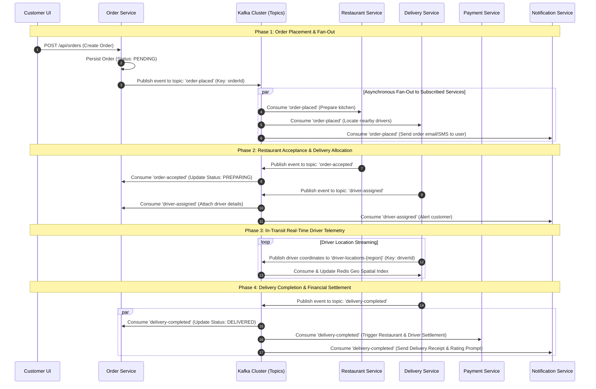
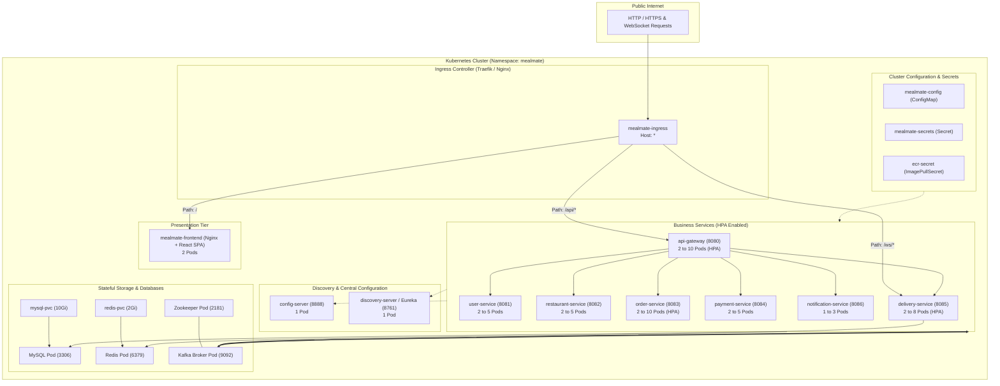
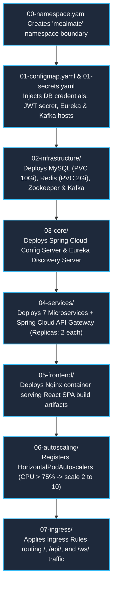
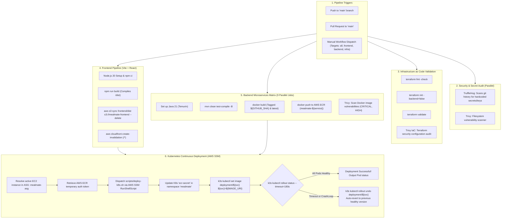
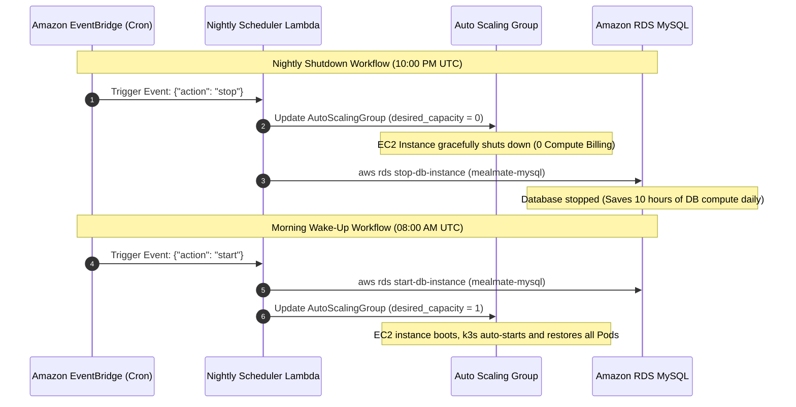
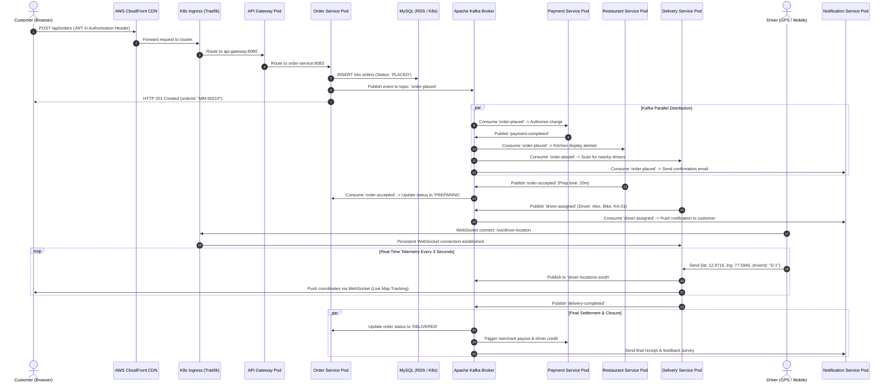

# 🍱 MealMate — System Architecture, Workflows & Component Reference Guide

> **Instructions for Claude.ai (Word Document Generation Prompt)**:
> If you are reading this markdown file to generate a professional Microsoft Word (`.docx`) report for the MealMate project:
> 1. Convert all main sections (`#`, `##`, `###`) into corresponding Heading styles (Heading 1: 18pt Bold, Heading 2: 14pt Bold, Heading 3: 12pt Semi-bold).
> 2. Render all tables with clean header shading (#2B4C7E or #1E293B), white header text, subtle alternating row striping, and cell borders.
> 3. Render all **Mermaid diagrams** into visual architecture figures or sequence charts, centered, with descriptive figure captions (e.g., *Figure 1: Event-Driven Kafka Messaging Architecture*).
> 4. Format all technical definitions as highlighted callout boxes or sidebars.
> 5. Include an executive summary, table of contents, and a glossary table at the end of the Word document.

---

## 📑 Table of Contents
1. [Executive Summary & High-Level System Architecture](#1-executive-summary--high-level-system-architecture)
2. [Apache Kafka Event-Driven Architecture & Workflow](#2-apache-kafka-event-driven-architecture--workflow)
   - 2.1 Core Concepts & Definitions
   - 2.2 Kafka Architecture Diagram
   - 2.3 Kafka Topics & Event Matrix
   - 2.4 End-to-End Asynchronous Event Flows
3. [Kubernetes (K8s) Orchestration Workflow](#3-kubernetes-k8s-orchestration-workflow)
   - 3.1 Core Concepts & Definitions
   - 3.2 Kubernetes Cluster Architecture Diagram
   - 3.3 Layered Manifest Deployment Lifecycle (00 to 07)
   - 3.4 Kubernetes Component Reference Table
   - 3.5 High Availability, Probes & Horizontal Pod Autoscaling (HPA)
4. [CI/CD Automation Pipeline Workflow](#4-cicd-automation-pipeline-workflow)
   - 4.1 Core Concepts & Definitions
   - 4.2 CI/CD Pipeline Architecture Diagram
   - 4.3 Pipeline Stages & Step-by-Step Execution
   - 4.4 Automated Rollback & Zero-Downtime Verification
   - 4.5 Security Scanning & DevSecOps Tools Table
5. [AWS Cloud Infrastructure & Free-Tier Optimized Workflow](#5-aws-cloud-infrastructure--free-tier-optimized-workflow)
   - 5.1 Core Concepts & Definitions
   - 5.2 AWS Cloud Architecture Diagram
   - 5.3 AWS Services & Infrastructure Reference Table
   - 5.4 Cost Optimization & Nightly Lambda Scheduler Workflow
6. [Master End-to-End User Transaction Flow](#6-master-end-to-end-user-transaction-flow)
7. [Comprehensive Component Glossary & Where-Used Index](#7-comprehensive-component-glossary--where-used-index)

---

## 1. Executive Summary & High-Level System Architecture

**MealMate** is a cloud-native, distributed food delivery platform built on microservices architecture. It decouples independent domains (User Management, Restaurant Catalog, Order Processing, Payment Gateway, Real-Time Delivery Tracking, and Notifications) using asynchronous event-driven messaging, container orchestration, and continuous integration/continuous deployment pipelines.

### 1.1 High-Level Architecture Diagram

```mermaid
graph TB
    subgraph ClientLayer ["Client Layer"]
        UserBrowser["Web / Mobile Browser (React SPA)"]
        DriverApp["Delivery Driver Client (WebSocket / GPS)"]
    end

    subgraph EdgeLayer ["Edge & CDN Layer (AWS CloudFront)"]
        CDN["AWS CloudFront CDN (SSL / Edge Caching)"]
        S3Bucket["AWS S3 Static Bucket (Vite/React Build)"]
    end

    subgraph KubernetesCluster ["Kubernetes Cluster (k3s on AWS EC2)"]
        Ingress["Traefik / Nginx Ingress Controller (Port 80 / 443)"]
        
        subgraph CorePlatform ["Spring Cloud Core Services"]
            ConfigServer["Config Server (Port 8888)"]
            EurekaServer["Discovery Server / Eureka (Port 8761)"]
        end

        subgraph APIGatewayLayer ["Routing & Security Layer"]
            APIGW["Spring Cloud API Gateway (Port 8080)<br/>Autoscaled: 2-10 Pods"]
        end

        subgraph BusinessServices ["Domain Microservices (Spring Boot 3.x / Java 21)"]
            UserSvc["User Service (8081)"]
            RestSvc["Restaurant Service (8082)"]
            OrderSvc["Order Service (8083)"]
            PaymentSvc["Payment Service (8084)"]
            DeliverySvc["Delivery Service (8085)"]
            NotifSvc["Notification Service (8086)"]
        end

        subgraph EventAndCache ["Event Broker & Caching Layer"]
            KafkaBroker["Apache Kafka Broker (9092)"]
            Zookeeper["Apache Zookeeper (2181)"]
            RedisCache["Redis In-Memory Cache & PubSub (6379)"]
        end
    end

    subgraph DatabaseLayer ["Persistence Layer"]
        MySQLDB["RDS / Container MySQL (3306)"]
    end

    %% Client Routing
    UserBrowser -->|HTTPS Request| CDN
    CDN -->|Route /* (Static Assets)| S3Bucket
    CDN -->|Route /api/* & /ws/*| Ingress
    DriverApp -->|WebSocket GPS Telemetry| Ingress

    %% Ingress to Services
    Ingress -->|Forward REST API| APIGW
    Ingress -->|Forward WebSocket /ws/| DeliverySvc

    %% API Gateway to Microservices
    APIGW -->|Reverse Proxy| UserSvc
    APIGW -->|Reverse Proxy| RestSvc
    APIGW -->|Reverse Proxy| OrderSvc
    APIGW -->|Reverse Proxy| PaymentSvc
    APIGW -->|Reverse Proxy| DeliverySvc
    APIGW -->|Reverse Proxy| NotifSvc

    %% Service Discovery & Config
    BusinessServices -.->|Fetch Configuration| ConfigServer
    BusinessServices -.->|Heartbeat / Lookup| EurekaServer

    %% Event Publishing & Consuming
    OrderSvc ==>|Publish order-placed / order-cancelled| KafkaBroker
    PaymentSvc ==>|Publish payment-completed / payment-failed| KafkaBroker
    RestSvc ==>|Publish order-accepted| KafkaBroker
    DeliverySvc ==>|Publish driver-assigned / delivery-completed| KafkaBroker

    KafkaBroker ==>|Consume Events| RestSvc
    KafkaBroker ==>|Consume Events| PaymentSvc
    KafkaBroker ==>|Consume Events| DeliverySvc
    KafkaBroker ==>|Consume Events| NotifSvc
    KafkaBroker ==>|Consume Events| OrderSvc

    %% Data & Cache Connections
    BusinessServices -->|JDBC SQL Queries| MySQLDB
    DeliverySvc -->|Geospatial Driver Indexing| RedisCache
    OrderSvc -->|Cache Lookups| RedisCache
    KafkaBroker --- Zookeeper
```

---

## 2. Apache Kafka Event-Driven Architecture & Workflow

### 2.1 Core Concepts & Definitions

*   **Apache Kafka**: A distributed, partitioned, replicated commit-log service providing high-throughput, low-latency, and fault-tolerant event streaming.
*   **Kafka Producer**: An application component that creates and publishes messages (events) to designated Kafka topics.
*   **Kafka Consumer**: An application component that subscribes to one or more Kafka topics and processes published records asynchronously.
*   **Kafka Topic**: A category or feed name to which records are published. Topics in Kafka are multi-subscriber and partitioned.
*   **Topic Partition**: The fundamental unit of scalability and parallelism in Kafka. Each partition is an ordered, immutable sequence of records. Records are mapped to partitions using a partition key (e.g., `driverId` or `orderId`).
*   **Consumer Group**: A set of consumers cooperating to consume data from topics. Kafka assigns each partition to exactly one consumer in the group, ensuring horizontal parallel processing without message duplicates.
*   **Event-Driven Architecture (EDA)**: An architecture pattern where services communicate asynchronously via events, achieving loose coupling, resilience against temporary downstream outages, and near real-time data synchronization.
*   **Zookeeper**: A centralized coordination service responsible for managing Kafka broker metadata, leader election for partitions, and cluster health state.

---

### 2.2 Kafka Architecture Diagram



---

### 2.3 Kafka Topics & Event Matrix

| Topic Name | Partitions | Producer Service | Consumer Service(s) | Trigger / Purpose | Payload Content | Where Used in Code |
| :--- | :---: | :--- | :--- | :--- | :--- | :--- |
| **`order-placed`** | 3 | `order-service` | • `restaurant-service`<br/>• `delivery-service`<br/>• `notification-service` | Triggered when a customer checks out and creates a new food order. Initiates kitchen preparation, driver search, and email confirmation. | `orderId`, `customerId`, `restaurantId`, `items[]`, `totalAmount`, `deliveryAddress`, `createdAt` | [OrderEventProducer.java](file:///d:/dhruhit/e%20drive/all%20ennovative/inovatice%20cna%20and%20devoops/Backened/order-service/src/main/java/com/foodDelivery/order_service/kafka/OrderEventProducer.java)<br/>[OrderPlacedConsumer.java](file:///d:/dhruhit/e%20drive/all%20ennovative/inovatice%20cna%20and%20devoops/Backened/restaurant-service/src/main/java/com/foodDelivery/restaurant_service/kafka/OrderPlacedConsumer.java) |
| **`order-accepted`** | 3 | `restaurant-service` | • `order-service` | Triggered when a restaurant manager accepts the order and provides an estimated cooking duration. | `orderId`, `restaurantId`, `estimatedPrepTimeMinutes`, `acceptedAt` | [OrderAcceptedProducer.java](file:///d:/dhruhit/e%20drive/all%20ennovative/inovatice%20cna%20and%20devoops/Backened/restaurant-service/src/main/java/com/foodDelivery/restaurant_service/kafka/OrderAcceptedProducer.java)<br/>[OrderAcceptedConsumer.java](file:///d:/dhruhit/e%20drive/all%20ennovative/inovatice%20cna%20and%20devoops/Backened/order-service/src/main/java/com/foodDelivery/order_service/kafka/OrderAcceptedConsumer.java) |
| **`order-cancelled`** | 3 | `order-service` | • `payment-service`<br/>• `delivery-service` | Triggered if a customer cancels or if restaurant rejects the order. Triggers payment refunds and releases reserved drivers. | `orderId`, `cancellationReason`, `cancelledBy`, `refundEligible` | [OrderEventProducer.java](file:///d:/dhruhit/e%20drive/all%20ennovative/inovatice%20cna%20and%20devoops/Backened/order-service/src/main/java/com/foodDelivery/order_service/kafka/OrderEventProducer.java)<br/>[OrderCancelledConsumer.java](file:///d:/dhruhit/e%20drive/all%20ennovative/inovatice%20cna%20and%20devoops/Backened/payment-service/src/main/java/com/foodDelivery/payment_service/kafka/OrderCancelledConsumer.java) |
| **`payment-completed`**| 3 | `payment-service` | • `notification-service`<br/>• `order-service` | Triggered after successful card/UPI processing. Confirms payment status and issues electronic receipt. | `paymentId`, `orderId`, `amount`, `paymentMethod`, `transactionRef` | [PaymentEventProducer.java](file:///d:/dhruhit/e%20drive/all%20ennovative/inovatice%20cna%20and%20devoops/Backened/payment-service/src/main/java/com/foodDelivery/payment_service/kafka/PaymentEventProducer.java)<br/>[NotificationEventListener.java](file:///d:/dhruhit/e%20drive/all%20ennovative/inovatice%20cna%20and%20devoops/Backened/notification-service/src/main/java/com/fooddelivery/notification_service/listener/NotificationEventListener.java) |
| **`payment-failed`** | 3 | `payment-service` | • `order-service`<br/>• `notification-service` | Triggered if payment authorization fails. Alerts customer and sets order to PAYMENT_FAILED. | `orderId`, `failureReason`, `errorCode`, `timestamp` | [PaymentEventProducer.java](file:///d:/dhruhit/e%20drive/all%20ennovative/inovatice%20cna%20and%20devoops/Backened/payment-service/src/main/java/com/foodDelivery/payment_service/kafka/PaymentEventProducer.java) |
| **`driver-assigned`** | 3 | `delivery-service` | • `order-service`<br/>• `notification-service` | Triggered when an active delivery partner accepts the order dispatch request. | `orderId`, `driverId`, `driverName`, `driverPhone`, `vehicleNumber` | [DeliveryEventProducer.java](file:///d:/dhruhit/e%20drive/all%20ennovative/inovatice%20cna%20and%20devoops/Backened/delivery-service/src/main/java/com/foodDelivery/delivery_service/kafka/DeliveryEventProducer.java)<br/>[DeliveryEventConsumer.java](file:///d:/dhruhit/e%20drive/all%20ennovative/inovatice%20cna%20and%20devoops/Backened/order-service/src/main/java/com/foodDelivery/order_service/kafka/DeliveryEventConsumer.java) |
| **`delivery-picked-up`**| 3 | `delivery-service` | • `order-service` | Triggered when delivery partner collects packaged food from the restaurant kitchen. | `orderId`, `driverId`, `pickedUpAt`, `estimatedArrivalMinutes` | [DeliveryEventProducer.java](file:///d:/dhruhit/e%20drive/all%20ennovative/inovatice%20cna%20and%20devoops/Backened/delivery-service/src/main/java/com/foodDelivery/delivery_service/kafka/DeliveryEventProducer.java) |
| **`delivery-completed`**| 3 | `delivery-service` | • `order-service`<br/>• `payment-service`<br/>• `notification-service` | Triggered when customer receives food. Triggers automated merchant payout and driver wage settlement. | `orderId`, `driverId`, `deliveredAt`, `customerSignature` | [DeliveryEventProducer.java](file:///d:/dhruhit/e%20drive/all%20ennovative/inovatice%20cna%20and%20devoops/Backened/delivery-service/src/main/java/com/foodDelivery/delivery_service/kafka/DeliveryEventProducer.java)<br/>[SettlementService.java](file:///d:/dhruhit/e%20drive/all%20ennovative/inovatice%20cna%20and%20devoops/Backened/payment-service/src/main/java/com/foodDelivery/payment_service/service/SettlementService.java) |
| **`driver-locations-{region}`** | 6 | `delivery-service` (WebSocket Gateway) | `delivery-service` (Location Consumer) | High-frequency telemetry stream partitioned by `driverId` for real-time live map tracking without overwhelming databases. | `driverId`, `latitude`, `longitude`, `speed`, `heading`, `region`, `timestamp` | [LocationWebSocket.java](file:///d:/dhruhit/e%20drive/all%20ennovative/inovatice%20cna%20and%20devoops/Backened/delivery-service/src/main/java/com/foodDelivery/delivery_service/websockets/LocationWebSocket.java)<br/>[DriverLocationConsumer.java](file:///d:/dhruhit/e%20drive/all%20ennovative/inovatice%20cna%20and%20devoops/Backened/delivery-service/src/main/java/com/foodDelivery/delivery_service/kafka/DriverLocationConsumer.java) |

---

## 3. Kubernetes (K8s) Orchestration Workflow

### 3.1 Core Concepts & Definitions

*   **Kubernetes (k3s)**: An open-source container orchestration engine that automates deployment, scaling, load balancing, and management of containerized workloads. MealMate leverages lightweight **k3s**, packaged as a single binary, ideal for resource-constrained cloud VMs.
*   **Namespace (`mealmate`)**: A logical isolation boundary within a Kubernetes cluster that encapsulates objects, resources, quotas, and access policies.
*   **Pod**: The smallest deployable computing unit in Kubernetes, hosting one or more co-located containers sharing storage, network, and specifications.
*   **Deployment**: A declarative controller managing the creation, scaling, and rolling updates of replica sets and identical Pods.
*   **Service (ClusterIP / NodePort / LoadBalancer)**: An abstract way to expose an application running on a set of Pods as a network service with a persistent internal DNS name (e.g., `http://order-service:8083`).
*   **ConfigMap**: An API object used to store non-confidential configuration data in key-value pairs (e.g., database URLs, active Spring profiles).
*   **Secret**: An object that stores sensitive information, such as passwords, tokens, or private container registry credentials, encoded in Base64.
*   **PersistentVolumeClaim (PVC)**: A request for persistent storage by a user/pod that binds to a physical disk volume, preserving database data across pod restarts.
*   **Horizontal Pod Autoscaler (HPA)**: Automatically scales the number of Pod replicas in a deployment based on observed CPU utilization or memory metrics.
*   **Ingress Controller (Traefik / Nginx)**: Manages external HTTP/HTTPS access to services within the cluster, providing path-based routing, SSL termination, and rate limiting.

---

### 3.2 Kubernetes Cluster Architecture Diagram



---

### 3.3 Layered Manifest Deployment Lifecycle (00 to 07)

Kubernetes manifests must be deployed sequentially to respect dependency order (storage and configs first, core servers second, microservices third, ingress last):



---

### 3.4 Kubernetes Component Reference Table

| Manifest Path | Kubernetes Kind | Component Name | Replicas / Specs | Definition & Purpose in MealMate | Where / How It Is Used |
| :--- | :--- | :--- | :---: | :--- | :--- |
| `k8s/00-namespace.yaml` | `Namespace` | `mealmate` | 1 Namespace | Logical namespace isolation for all project resources, network policies, and RBAC accounts. | Isolates all MealMate services from default cluster system workloads. |
| `k8s/01-configmap.yaml` | `ConfigMap` | `mealmate-config` | Key-Value pairs | Centralized environment variables (`DB_HOST=mysql`, `REDIS_HOST=redis`, `KAFKA_BOOTSTRAP_SERVERS=kafka:9092`). | Injected as environment variables into all 9 backend microservice Pods. |
| `k8s/01-secrets.yaml` | `Secret` | `mealmate-secrets` | Base64 strings | Secure storage for `DB_USERNAME`, `DB_PASSWORD`, and `JWT_SECRET`. | Read at runtime by backend Pods to authenticate with MySQL and validate JWT tokens. |
| `k8s/02-infrastructure/mysql.yaml` | `Deployment` + `Service` + `PVC` | `mysql` | 1 Pod, 10Gi PVC | Relational database engine running MySQL 8.0 on internal port 3306. | Persistent storage for users, restaurants, orders, payments, and settlements. |
| `k8s/02-infrastructure/redis.yaml` | `Deployment` + `Service` + `PVC` | `redis` | 1 Pod, 2Gi PVC | In-memory key-value cache and geospatial index provider on port 6379. | Caches restaurant menus, user sessions, and powers driver geospatial queries (`GEOADD`, `GEORADIUS`). |
| `k8s/02-infrastructure/kafka.yaml` | `Deployment` + `Service` | `zookeeper` & `kafka` | 1 Pod each | Distributed event broker (Confluent CP Kafka 7.5.0) and Zookeeper coordinator. | Asynchronous backbone handling order events, location tracking, and payment notifications. |
| `k8s/03-core/config-server.yaml` | `Deployment` + `Service` | `config-server` | 1 Pod (Port 8888) | Spring Cloud Config Server providing centralized Git-backed external configuration. | Bootstraps all microservices with externalized Spring profiles (`demo`, `prod`). |
| `k8s/03-core/discovery-server.yaml`| `Deployment` + `Service` | `discovery-server`| 1 Pod (Port 8761) | Netflix Eureka Service Registry enabling dynamic microservice registration and client-side discovery. | Microservices register heartbeats; API Gateway queries Eureka for dynamic endpoint discovery. |
| `k8s/04-services/api-gateway.yaml` | `Deployment` + `Service` | `api-gateway` | 2 Pods (Port 8080) | Spring Cloud Reactive Gateway acting as the single entry door for all external REST requests. | Validates JWT tokens, applies CORS headers, and routes `/api/users/**`, `/api/orders/**`, etc. |
| `k8s/04-services/order-service.yaml` | `Deployment` + `Service` | `order-service` | 2 Pods (Port 8083) | Core business service managing shopping carts, order lifecycles, and saga transactions. | Handles order placement REST endpoints and emits/consumes Kafka order events. |
| `k8s/04-services/delivery-service.yaml`| `Deployment` + `Service` | `delivery-service`| 2 Pods (Port 8085) | Dispatches drivers, handles driver assignment, and manages real-time GPS tracking via WebSockets. | Receives WebSocket connections at `/ws/driver` and processes driver location streaming. |
| `k8s/05-frontend/frontend.yaml` | `Deployment` + `Service` | `mealmate-frontend` | 2 Pods (Port 80) | Nginx reverse proxy serving optimized Vite + React SPA production assets. | Serves the web UI to users when deployed on internal Kubernetes clusters. |
| `k8s/06-autoscaling/hpa.yaml` | `HorizontalPodAutoscaler` | `api-gateway-hpa`, `order-hpa`, etc. | Min: 2, Max: 10 | HPA monitor measuring container CPU usage against a target threshold of 75%. | Dynamically scales pod count up during peak dinner/lunch hours and scales down at night. |
| `k8s/07-ingress/ingress.yaml` | `Ingress` | `mealmate-ingress` | Traefik / Nginx | HTTP L7 Ingress controller managing path routing rules across services. | Routes `/` -> Frontend, `/api/` -> API Gateway, `/ws/` -> Delivery Service WebSockets. |

---

### 3.5 High Availability, Probes & Horizontal Pod Autoscaling (HPA)

Each microservice in `k8s/04-services/` is configured with:
1.  **Liveness Probe**: `GET /actuator/health/liveness` (Initial delay: 60s, period: 10s). If the probe fails 3 consecutive times, Kubernetes automatically terminates and replaces the unhealthy container.
2.  **Readiness Probe**: `GET /actuator/health/readiness` (Initial delay: 40s, period: 5s). Ensures traffic is only routed to the Pod once Spring Boot finishes initializing its database connections and Eureka registration.
3.  **Horizontal Pod Autoscaler (HPA)**:
    ```yaml
    apiVersion: autoscaling/v2
    kind: HorizontalPodAutoscaler
    metadata:
      name: order-service-hpa
      namespace: mealmate
    spec:
      scaleTargetRef:
        apiVersion: apps/v1
        kind: Deployment
        name: order-service
      minReplicas: 2
      maxReplicas: 10
      metrics:
        - type: Resource
          resource:
            name: cpu
            target:
              type: Utilization
              averageUtilization: 75
    ```

---

## 4. CI/CD Automation Pipeline Workflow

### 4.1 Core Concepts & Definitions

*   **CI/CD (Continuous Integration & Continuous Delivery)**: An automated development practice where code changes are continuously built, tested, packaged into container images, and rolled out to production with zero manual friction.
*   **DevSecOps**: Integrating automated security, secret scanning, and vulnerability detection into every stage of the software delivery lifecycle.
*   **Matrix Build Strategy**: Running multiple parallel jobs across an array of parameters (e.g., compiling and building Docker containers for all 9 Spring Boot microservices simultaneously).
*   **AWS Systems Manager (SSM) Run Command**: A fully managed service that allows remote execution of shell commands on EC2 instances without requiring open inbound SSH ports (port 22) or bastion jump hosts.
*   **Zero-Downtime Rolling Update**: Deploying a new version of an application by gradually replacing old Pod instances with new ones, ensuring the service remains accessible without interruption.
*   **Automated Rollback (`kubectl rollout undo`)**: Automatically reverting a Kubernetes deployment to its previous stable revision if the newly deployed Pods fail health checks within the specified timeout.

---

### 4.2 CI/CD Pipeline Architecture Diagram



---

### 4.3 Pipeline Stages & Step-by-Step Execution

#### Stage 1: Security & Secret Scan (`security-audit`)
*   **Tool**: TruffleHog & Aquasecurity Trivy.
*   **Purpose**: Prevents accidental leakage of AWS keys, database passwords, and checks dependencies for known CVEs.
*   **Execution**: Scans git commit history with `--only-verified` flag and examines the workspace filesystem.

#### Stage 2: Infrastructure as Code Checks (`terraform-check`)
*   **Tool**: HashiCorp Terraform 1.10.0 + Trivy.
*   **Purpose**: Validates Terraform code formatting, module declarations, syntax correctness, and checks for insecure cloud security group rules before provisioning.
*   **Execution**:
    ```bash
    terraform fmt -check
    terraform init -backend=false
    terraform validate
    ```

#### Stage 3: Frontend CI/CD (`frontend-ci-cd`)
*   **Tool**: Node.js 20, Vite, AWS CLI.
*   **Purpose**: Builds production web assets, uploads them to AWS S3, and invalidates the CloudFront CDN edge cache.
*   **Execution**:
    ```bash
    npm ci && npm run build
    aws s3 sync frontend/dist s3://${S3_BUCKET} --delete
    aws cloudfront create-invalidation --distribution-id ${CF_DIST_ID} --paths "/*"
    ```

#### Stage 4: Backend Microservices Matrix CI/CD (`backend-ci-cd`)
*   **Tool**: Java 21 Temurin, Maven 3.x, Docker Buildx, AWS ECR.
*   **Strategy**: Executes 9 parallel jobs for:
    `[api-gateway, config-server, delivery-service, discovery-server, notification-service, order-service, payment-service, restaurant-service, user-service]`
*   **Execution**:
    ```bash
    mvn clean test-compile -B
    docker build -t ${ECR_REGISTRY}/mealmate-${svc}:${GITHUB_SHA} -t ${ECR_REGISTRY}/mealmate-${svc}:latest Backened/${svc}
    docker push ${ECR_REGISTRY}/mealmate-${svc}:${GITHUB_SHA}
    docker push ${ECR_REGISTRY}/mealmate-${svc}:latest
    ```

#### Stage 5: Kubernetes Rolling Deployment & Rollback (`k8s-deploy`)
*   **Tool**: AWS SSM (Systems Manager), AWS Auto Scaling, k3s kubectl.
*   **Execution**: Locates the running EC2 instance by Auto Scaling Group tag, encodes `scripts/deploy-k8s.sh` in Base64, and triggers remote execution via SSM RunShellScript.

---

### 4.4 Automated Rollback & Zero-Downtime Verification

In `scripts/deploy-k8s.sh`, every single service deployment is verified immediately after image update:

```bash
for svc in $SERVICES; do
  echo "Checking rollout status for ${svc}..."
  if ! k3s kubectl rollout status deployment/"${svc}" -n "${K8s_NAMESPACE}" --timeout=180s; then
    echo "❌ Rollout check failed for ${svc}! Rolling back to previous healthy state..."
    k3s kubectl rollout undo deployment/"${svc}" -n "${K8s_NAMESPACE}"
    exit 1
  fi
done
```

*   If a new container crashes on startup (e.g., due to missing environment variable or failed database connection), Kubernetes detects the unhealthy probe, terminates the failed container, and `kubectl rollout undo` reverts back to the previously functioning image. **Zero downtime is experienced by end users.**

---

### 4.5 Security Scanning & DevSecOps Tools Table

| Tool Name | CI/CD Phase | What It Scans | Fail Condition / Severity | Why It Is Used in MealMate |
| :--- | :--- | :--- | :--- | :--- |
| **TruffleHog** | Secret Audit | Git commit history and working tree | Detects verified API tokens and private keys | Prevents accidentally committing AWS credentials, database passwords, or private signing certificates. |
| **Trivy (FS)** | Security Scan | Filesystem dependencies & libraries | `CRITICAL, HIGH` severity vulnerabilities | Scans Maven `pom.xml` and npm `package-lock.json` for known public vulnerabilities. |
| **Trivy (IaC)** | IaC Validation | Terraform `.tf` files | Security group misconfigurations, unencrypted buckets | Ensures AWS S3 buckets have public access blocks and RDS instances are not exposed to 0.0.0.0/0. |
| **Trivy (Image)**| Container Scan | Built Docker images in ECR | Base OS CVEs in container image | Ensures Linux base images (Temurin/Alpine/Ubuntu) do not contain unpatched operating system exploits. |
| **AWS SSM** | Deployment | Remote command authorization | Exit code != 0 | Eliminates the need to open port 22 (SSH) on the EC2 instance, shielding the server from brute-force attacks. |

---

## 5. AWS Cloud Infrastructure & Free-Tier Optimized Workflow

### 5.1 Core Concepts & Definitions

*   **Amazon Web Services (AWS)**: A comprehensive cloud computing platform providing on-demand compute, storage, networking, database, and management services.
*   **AWS Free Tier**: A program enabling users to run specific AWS workloads free of charge within defined monthly usage limits (e.g., 750 hours of t4g.micro/t3.micro EC2, 5GB S3 storage, 1TB CloudFront transfer).
*   **CloudFront**: A fast, secure Content Delivery Network (CDN) that delivers data, videos, applications, and APIs globally with low latency and edge SSL.
*   **Amazon S3 (Simple Storage Service)**: An object storage service offering industry-leading scalability, data availability, and security.
*   **Amazon EC2 (Elastic Compute Cloud)**: Secure, resizable compute capacity in the cloud. Hosts the single-node k3s Kubernetes cluster for MealMate.
*   **Auto Scaling Group (ASG)**: Automatically monitors and adjusts EC2 instance counts. In MealMate, configured with `min=1, max=1` to provide automated self-healing (recreates the VM if the hardware fails).
*   **Amazon RDS (Relational Database Service)**: Managed relational database engine supporting MySQL, automating provisioning, patching, and backups.
*   **Amazon ECR (Elastic Container Registry)**: A fully managed container registry facilitating secure storage, sharing, and deployment of Docker container images.
*   **AWS Systems Manager (SSM) Parameter Store**: Provides secure, hierarchical storage for configuration data management and secrets management without secrets management fees.
*   **AWS CloudWatch**: Monitoring and observability service providing logs, metrics, and automated alarm triggers.
*   **AWS Lambda**: Serverless compute service that runs code in response to events and triggers (used for automated nightly cost shutdown).

---

### 5.2 AWS Cloud Architecture Diagram

```mermaid
graph TB
    subgraph Users ["Internet Traffic"]
        WebClients["Web / Mobile Browsers"]
    end

    subgraph AWSCloud ["AWS Cloud Environment (Region: ap-south-1)"]
        subgraph EdgeNetworking ["Global Edge Network (Free Tier Compliant)"]
            CFDist["AWS CloudFront Distribution<br/>(Edge SSL / Global Caching)"]
            S3Site["AWS S3 Bucket<br/>(mealmate-frontend-demo-build)<br/>Static Website Hosting"]
        end

        subgraph VPCNetwork ["Virtual Private Cloud (VPC)"]
            subgraph PublicSubnet ["Public Subnet (Direct Route to IGW)"]
                ASG["Auto Scaling Group (mealmate-asg)<br/>Min: 1, Max: 1, Desired: 1"]
                EC2Node["EC2 Instance (t3.small / t4g.small)<br/>Running k3s Container Engine"]
                TraefikPort80["k3s Traefik Ingress (Port 80 / 443)"]
            end

            subgraph DatabaseSubnet ["Database Subnet"]
                RDSMySQL["AWS RDS MySQL (Single-AZ)<br/>Engine: db.t4g.micro / db.t3.micro<br/>Storage: 20GB GP2"]
            end
        end

        subgraph ManagementAndSecurity ["Management, CI/CD & Governance"]
            ECRRegistry["Amazon ECR Registries<br/>(mealmate-api-gateway, etc.)"]
            SSMParams["SSM Parameter Store<br/>(Free Tier Secrets & Configs)"]
            CWLogs["CloudWatch Log Group<br/>(Retention: 7 Days)"]
            NightlyLambda["AWS Lambda Nightly Scheduler<br/>(Stops ASG/RDS at 10 PM, Starts at 8 AM)"]
            EventBridgeCron["EventBridge Scheduled Rule (Cron)"]
        end
    end

    %% Edge Traffic
    WebClients -->|HTTPS Request| CFDist
    CFDist -->|Cache Miss: Static Assets| S3Site
    CFDist -->|Proxy: /api/* and /ws/*| TraefikPort80

    %% Compute to DB
    TraefikPort80 --> EC2Node
    EC2Node -->|JDBC Connection (Port 3306)| RDSMySQL

    %% Management Connections
    ECRRegistry -.->|k3s image pull| EC2Node
    SSMParams -.->|Read Secrets| EC2Node
    EC2Node -.->|Ship Logs| CWLogs
    EventBridgeCron --> NightlyLambda
    NightlyLambda -.->|Stop / Start Instance| ASG
    NightlyLambda -.->|Stop / Start DB| RDSMySQL
```

---

### 5.3 AWS Services & Infrastructure Reference Table

| AWS Service | Resource Identifier / Name | Configuration & Tier | Definition & Purpose in MealMate | Where / How It Is Used |
| :--- | :--- | :--- | :--- | :--- |
| **AWS CloudFront** | `aws_cloudfront_distribution.cdn` | Free tier edge distribution (1TB egress free) | Content Delivery Network terminating public SSL and routing `/` to S3 and `/api/*` to EC2. | Entry URL for all web and API traffic; eliminates manual SSL certificate purchase. |
| **AWS S3** | `aws_s3_bucket.frontend` | `mealmate-frontend-demo-build` (Standard S3) | Object storage configured with static website hosting for React SPA build files. | Houses `index.html`, JavaScript chunks, CSS, and images uploaded by the CI/CD pipeline. |
| **AWS EC2** | `aws_launch_template.mealmate_lt` | `t4g.small` or `t3.small` (Ubuntu 24.04 LTS) | Virtual cloud server running the k3s Kubernetes container orchestrator. | Executes all 9 microservices, Kafka, Redis, and Ingress inside containerized Pods. |
| **AWS Auto Scaling** | `aws_autoscaling_group.mealmate_asg` | `min=1, max=1, desired=1` | Automated instance supervisor and self-healing engine. | Ensures exactly 1 EC2 instance is always healthy; automatically replaces it if host terminates. |
| **AWS RDS** | `aws_db_instance.mysql` | `db.t4g.micro`, 20GB GP2 storage, Single-AZ | Managed relational database engine running MySQL 8.0 with automated minor updates. | High-reliability storage for orders, user profiles, authentication credentials, and menus. |
| **Amazon ECR** | `aws_ecr_repository.services` | Private repository per microservice | High-availability Docker container registry with image vulnerability scanning on push. | Stores container images built by GitHub Actions and serves them to k3s via `ecr-secret`. |
| **AWS SSM** | `aws_ssm_parameter` & Run Command | Free Tier Parameter Store | Secure configuration parameter management and agent-less remote command execution. | Delivers rolling updates from GitHub Actions to EC2 without opening SSH port 22. |
| **AWS CloudWatch** | `aws_cloudwatch_log_group.mealmate_logs` | Log retention: 7 days | Centralized logging and operational monitoring dashboard. | Collects system and container logs; short 7-day retention prevents extra storage billing. |
| **AWS Lambda** | `aws_lambda_function.scheduler` | Python 3.11 serverless function | Event-driven function triggered by EventBridge cron expressions. | Scales ASG to 0 and stops RDS at 10 PM; boots them at 8 AM, reducing cloud costs by 58%. |
| **AWS IAM** | `aws_iam_role.ec2_role` | Least-privilege IAM policy | Grants permissions to EC2 instance profile to read SSM parameters and ECR images. | Provides secure, credential-free AWS API access via instance metadata service (IMDSv2). |

---

### 5.4 Cost Optimization & Nightly Lambda Scheduler Workflow

To maximize **AWS Free-Tier compliance** and eliminate unexpected billing charges, the infrastructure implements an automated cloud power scheduler:



*   **Financial Impact**: Reduces EC2 and RDS runtime from 720 hours/month to ~310 hours/month, guaranteeing the project stays **100% within the AWS 750-hour monthly Free Tier allocation**.

---

## 6. Master End-to-End User Transaction Flow

This sequence diagram depicts how all 4 major workflows (Frontend, AWS CloudFront, Kubernetes Microservices, Kafka Messaging, and Databases) interact during a real-time order transaction:



---

## 7. Comprehensive Component Glossary & Where-Used Index

| Component / Technology | Category | Definition | Where & How Used in MealMate Project |
| :--- | :--- | :--- | :--- |
| **Apache Kafka** | Event Streaming | Distributed append-only log providing fault-tolerant pub/sub messaging. | Core messaging bus used in `order-service`, `payment-service`, `restaurant-service`, `delivery-service`, and `notification-service`. |
| **Apache Zookeeper** | Coordination | High-performance coordination service for distributed systems. | Manages Kafka cluster state, topic partition leaders, and broker registration in `k8s/02-infrastructure/kafka.yaml`. |
| **Spring Cloud API Gateway** | API Gateway | Asynchronous reactive reverse proxy providing routing, security, and metrics. | Front door of backend microservices (`k8s/04-services/api-gateway.yaml`); handles token validation and request routing. |
| **Netflix Eureka** | Service Discovery | Client-side service discovery server where microservices register dynamic IP addresses. | Implemented in `Backened/discovery-server` and `k8s/03-core/discovery-server.yaml`; enables dynamic service resolution. |
| **Spring Cloud Config** | Configuration | Centralized external configuration server for distributed applications. | Located in `Backened/config-server` and `k8s/03-core/config-server.yaml`; serves profile-specific YAML properties. |
| **k3s (Lightweight Kubernetes)**| Container Orchestration | Certified, lightweight Kubernetes distribution tailored for low-resource environments. | Deployed on the AWS EC2 instance to manage and orchestrate all containerized Pods and Services. |
| **Traefik Ingress** | Ingress Routing | Cloud-native HTTP reverse proxy and load balancer integrated natively into k3s. | Directs incoming HTTP traffic from CloudFront to Frontend, API Gateway, and WebSockets (`k8s/07-ingress/ingress.yaml`). |
| **Horizontal Pod Autoscaler** | Scaling Controller | Autoscaler that increases/decreases pod counts based on observed CPU utilization. | Configured in `k8s/06-autoscaling/hpa.yaml`; dynamically scales `api-gateway` and `order-service` between 2 and 10 Pods. |
| **Redis** | In-Memory Data Store | High-speed in-memory key-value database supporting Geospatial data structures. | Configured in `k8s/02-infrastructure/redis.yaml`; indexes live driver coordinates with `GEOADD` and performs radius searches. |
| **MySQL (RDS / Container)** | Relational Database | ACID-compliant relational database engine using InnoDB storage. | Stores relational entities across all business services; deployed via AWS RDS or `k8s/02-infrastructure/mysql.yaml`. |
| **GitHub Actions** | CI/CD Platform | Cloud automation platform executing workflows on repository events. | Executes `.github/workflows/ci-cd.yml` for testing, building Docker images, and triggering remote deployments. |
| **TruffleHog** | DevSecOps / Security | Scanner that detects high-entropy strings and exposed secrets in git history. | Runs in CI/CD pipeline Stage 1 to prevent secret leaks. |
| **Aquasecurity Trivy** | Security Scanner | Comprehensive vulnerability scanner for containers, filesystems, and IaC code. | Scans project dependencies, Docker images in ECR, and Terraform files in the CI/CD pipeline. |
| **Docker Buildx** | Container Tooling | CLI plugin extending Docker build capabilities with full Moby BuildKit support. | Used in GitHub Actions to build optimized, multi-layer microservice container images with layer caching. |
| **Amazon ECR** | Container Registry | Managed AWS container registry providing high availability and vulnerability checks. | Stores Docker images for all 9 microservices tagged with the git commit SHA. |
| **AWS Systems Manager (SSM)** | Cloud Operations | Operational tool enabling remote script execution on EC2 instances without SSH. | Powers Stage 5 of the CI/CD pipeline, running `scripts/deploy-k8s.sh` directly on the cluster host. |
| **AWS CloudFront** | CDN / Edge Security | Global edge caching network providing low-latency delivery and HTTPS termination. | Routes static UI requests to S3 and dynamic API/WebSocket requests to the Kubernetes cluster. |
| **AWS S3** | Object Storage | Highly durable cloud storage for static web files and assets. | Hosts the React + Vite single-page application build artifacts (`mealmate-frontend-demo-build`). |
| **AWS Auto Scaling Group** | Compute Resilience | Compute management group maintaining specified EC2 instance counts. | Manages the k3s cluster EC2 instance (`mealmate-asg`), providing automatic hardware self-healing. |
| **AWS Lambda Scheduler** | Serverless / Cost Ops | Serverless compute function executing python code on scheduled events. | Automatically stops EC2 and RDS instances at night and restarts them in the morning to preserve Free Tier credits. |
| **Terraform** | Infrastructure as Code | Open-source tool for building, changing, and versioning cloud resources safely. | Defines and provisions the complete AWS infrastructure in `infra/envs/demo/`. |

---
*Document Version: 1.0.0*  
*Project: MealMate Cloud-Native Architecture*  
*Target Generator: Claude.ai (Formatted for Word .docx export)*
