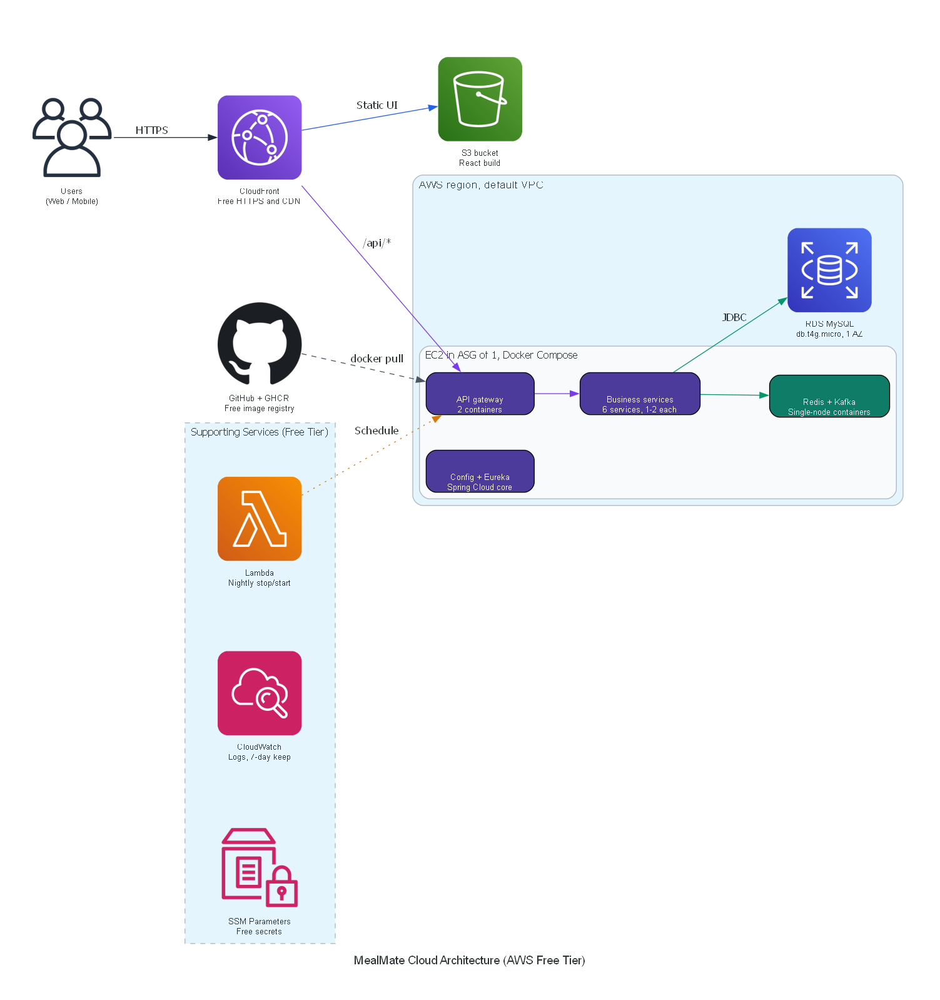

# 🏗️ MealMate AWS Free-Tier Infrastructure (`infra/`)

This directory contains the production-grade **AWS Free-Tier Terraform Architecture** for MealMate. The infrastructure is strictly compliant with the AWS 12-Month Free Tier limits while supporting the full 17-container microservices platform.

---

## 🏛️ Architecture



### Architectural Overview
- **Users**: Access the platform over secure HTTPS via CloudFront.
- **CloudFront CDN**: Provides free SSL/TLS termination, caching, and path-based routing:
  - Static React SPA assets routed to the **S3 Bucket**.
  - Dynamic API traffic (`/api/*`) routed to **Traefik Ingress** (built into k3s on port 80) on the EC2 host.
- **GitHub + GHCR**: Free container image registry used by the EC2 k3s host during deployment.
- **AWS Region, Default VPC**:
  - **EC2 running k3s (Kubernetes)**: In an Auto Scaling Group of 1 with 4GB Swap space:
    - *Traefik Ingress*: Built into k3s, listens on port 80 and routes incoming traffic.
    - *Spring Cloud Core* (Purple): Config + Eureka (Deployment, 1 pod).
    - *API Gateway* (Purple): 2 pods + Horizontal Pod Autoscaler (HPA).
    - *Business Services* (Purple): 6 Deployments (1-2 pods each) for User, Restaurant, Order, Delivery, Payment, and Notification.
    - *Data & Messaging* (Teal): Kafka + Redis (StatefulSets, 1 pod each).
  - **RDS MySQL** (Teal): Single-AZ `db.t4g.micro` instance with 20 GB gp2 storage (100% Free-Tier eligible).
- **Supporting Services**:
  - **SSM Parameter Store**: Free encrypted configuration parameters and database secrets.
  - **CloudWatch Logs**: Centralized container log group with a strict 7-day retention policy.
  - **Terraform + kubectl**: Automates provisioning and manifest deployment.

---

## 📊 Generated Architecture Diagrams

| File | Format | Best Used For |
|---|---|---|
| [`docs/terraform-graph.svg`](../docs/terraform-graph.svg) | SVG | **Debugging**: Full internal Terraform technical dependency DAG |
| [`docs/inframap.svg`](../docs/inframap.svg) | SVG | **Review**: Clean resource-to-resource connection diagram generated via Inframap |
| [`docs/architecture.png`](../docs/architecture.png) | PNG (Raster) | **Presentation**: Presentation diagram with AWS icons, container clusters & color coding |
| [`docs/architecture.svg`](../docs/architecture.svg) | SVG (Vector) | **Presentation**: High-resolution vector diagram for slide decks and print |
| [`docs/plan.json`](../docs/plan.json) | JSON | **Auditing**: Machine-readable plan metadata used to programmatically verify resources |

---

## 🛠️ How to Generate Diagrams

To regenerate all diagrams after making infrastructure changes, run:

```bash
cd infra
make diagram
```

Or run via the automated Python script:

```bash
python docs/make_diagram.py
```
